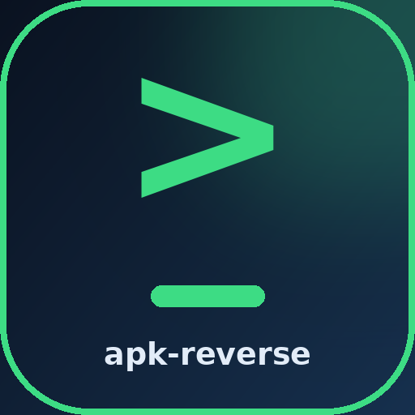

<p align="center">
  <picture>
    <source media="(prefers-color-scheme: dark)" srcset="assets/banner-dark.png">
    <source media="(prefers-color-scheme: light)" srcset="assets/banner-light.png">
    
  </picture>
</p>

<h1 align="center"> apk-reverse · 手机版逆向skill</h1>
<h3 align="center">Android APK 逆向研究技能包</h3>

<p align="center">
  <a href="https://github.com/xiaotianya14/apk-reverse-skill/releases"></a>
  <a href="https://github.com/xiaotianya14/apk-reverse-skill/stargazers"></a>
  <a href="https://github.com/xiaotianya14/apk-reverse-skill/forks"></a>
  <a href="https://github.com/xiaotianya14/apk-reverse-skill/issues"></a>
  
  
</p>

<p align="center">
  <a href="README.md">English</a> | <strong>中文</strong>
</p>

> **免责声明**：本项目仅用于学习研究与**自己拥有或已获授权**应用的逆向分析；
> 使用者自行承担数据丢失、设备与法律风险；不得用于攻击他人设备、未授权修改他人应用或违反平台条款。
> 不提供任何担保，作者不对使用后果负责。

一个在 Android 手机上跑的 APK 逆向作业规范 + 可执行脚本：解包 / 反编译 / 代码与资源分析 /
补丁 / 重打包签名 / 真机验证。命令在 proot Ubuntu（ARM64）实测可用，普通 Linux 也能跑。

## 能力

- 反编译：jadx 源码、apktool 资源与 smali、smali3、CFR
- 组件与广告分析：SDK 特征、清单/布局/资源定位
- 逻辑分析：付费/权益判定、数值逻辑、存档（SharedPreferences/SQLite）
- 补丁：smali 定点补丁、静态字段、原生 `.so` 指令补丁
- 保护分析：加固壳、签名校验、完整性校验的识别与适配
- 动态与网络分析：Frida / objection、mitmproxy、证书固定适配
- 交付：重打包、对齐、签名、真机安装验证

## 快速开始

```sh
SK=/path/to/apk-reverse

bash $SK/scripts/toolcheck.sh                 # 工具自检
bash $SK/scripts/install_tools.sh             # 自动安装缺失工具

bash $SK/scripts/decode.sh app.apk --out ./work      # 解码
python3 $SK/scripts/manifest_summary.py ./work       # 清单摘要
python3 $SK/scripts/scan_premium.py ./work           # 付费/权益候选
python3 $SK/scripts/find_api_calls.py ./work         # 接口线索
bash $SK/scripts/build_sign.sh ./work out.apk        # 重打包 + 签名
```

工具下载会按 `scripts/download-sha256.txt` 校验 SHA256：不一致会中止安装；
未钉版本的会打印实际哈希并 WARN，便于补表。

发布：`bash scripts/make_release.sh --name apk-reverse --public` 生成 zip、`.sha256`，并解压复检。
收包校验：`bash scripts/verify_release.sh <zip>`（读 `.sha256` 或 `SHA256SUMS`）。

发布到 GitHub：`bash scripts/publish_github.sh --repo https://github.com/<你>/apk-reverse.git --tag v0.0.2 --release`。
Token 从 `$GITHUB_TOKEN` 或 `~/.config/dsh-go/github-token` 读，不写入仓库。

## 仓库结构

```text
apk-reverse/
├── SKILL.md          # 路由 / 工作流 / 补丁模式 / 规则
├── references/       # 专题文档
├── scripts/          # 可执行工具
├── field-journal/    # 可复用的过程记录（现象 → 根因 → 解决）
├── AGENTS.md         # Agent 激活与同意边界
├── SECURITY.md       # 信任模型与安全问题报告
├── CONTRIBUTING.md   # 贡献规范
├── CHANGELOG.md      # 变更记录
├── VERSION           # 版本号（唯一来源）
└── LICENSE           # MIT
```

## 文档

- `references/identity-check.md` — 本地身份卡，不联网查应用
- `references/mobile-toolchain.md` — 工具链与安装
- `references/patch-patterns.md` — smali/清单/布局补丁
- `references/protection-map.md` — 加固/完整性/抓包
- `references/device-verify.md`、`references/device-control.md` — 真机验证与操控
- `references/security-audit.md` — 导出组件、WebView、密钥
- 完整索引见 `SKILL.md` 末尾


## 发行包校验

对外分发 zip 时配套 `SHA256SUMS`（或 `<包>.sha256`），接收方执行：

```sh
sha256sum -c SHA256SUMS
# 或
bash scripts/verify_release.sh apk-reverse.zip SHA256SUMS
```

## 图标

<p align="center">
  
</p>

## 贡献者

<a href="https://github.com/xiaotianya14/apk-reverse-skill/graphs/contributors">
  
</a>

## 许可

MIT，见 [LICENSE](LICENSE)。使用前请阅读顶部免责声明。
